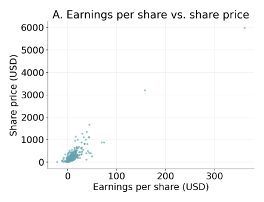
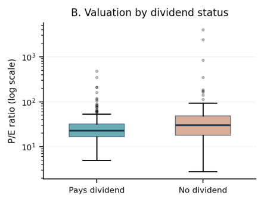
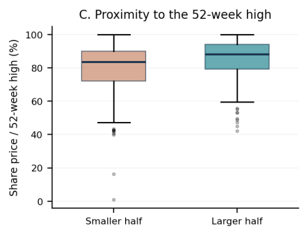

# Exploring Company Size, Dividends, and Stock Prices in the S&P 500

**ENGR 315 – Computational Methods | Team: Group 30**

**Contributors:** Aden Pierce, Grant Tiller, Sawyer Dole

---

## Objective and Motivation

We chose the S&P 500 because we are interested in how basic company financials relate to stock prices and valuation. The project also gives us a chance to use Python on real data instead of a made-up example. Our goal is to compare companies at one point in time and see which relationships hold up under testing. We are **not** trying to predict which stocks to buy.

As college students preparing to enter the workforce, we find this project personally interesting because it connects our engineering coursework with financial questions that will become more relevant as we begin earning salaries and planning for the future. Studying company size, earnings, dividends, and stock prices helps us understand the financial terms we encounter in discussions about businesses and investing. For Sawyer, this also connects with an interest in entrepreneurship and eventually owning a business. For our team and peers, the project makes statistics and Python more tangible by applying them to recognizable companies. We want to become more confident interpreting financial data and evaluating claims critically, while recognizing that these analyses alone cannot determine whether a stock is a good investment.

### Dataset

| Item | Details |
|---|---|
| Source | DataHub, *S&P 500 Companies with Financial Information* [1] |
| File | `constituents-financials.csv` (503 companies, 14 columns, ~95 KB) |
| Origin | Company list compiled from Wikipedia; financial measures gathered from Yahoo Finance using Python tools |
| Type | A single snapshot in time (**not** a historical time series) |
| Columns used | Price, Earnings/Share, Price/Earnings, Dividend Yield, Market Cap, 52 Week High |
| Direct download | https://datahub.io/core/s-and-p-500-companies-financials/_r/-/data/constituents-financials.csv |

A copy of the CSV is stored in [`data/`](data/) so the analysis can be reproduced.

### Questions, Expected Form of Answers, and Benefits

| # | Question | Form of the expected answer | Potential benefit |
|---|---|---|---|
| **Q2** | How do P/E ratios differ between dividend-paying and non-dividend-paying companies? | Group sizes, medians, and means; a Welch t-test p-value; a Mann–Whitney p-value; an effect size | Shows whether dividend policy goes along with how highly the market values a company's earnings |
| **Q3** | How does company size relate to proximity to the 52-week stock-price high? | Mean and median % of 52-week high for the larger and smaller halves; Welch t-test and Mann–Whitney p-values; an effect size; Spearman ρ | Shows whether large companies have held up better against their recent highs than smaller ones |
| **Q4** | How does earnings per share relate to current share price? | A fitted line (slope, intercept), R², Pearson r, Spearman ρ, and how the fit changes when influential points are removed | Tests how much of a share price is explained by earnings alone, and how much is left over |

**Questions we considered but did not select**
- **Q1:** How strongly is EBITDA related to market capitalization? (Feasible, but not selected.)
- **Q5:** How do changes in interest rates relate to five-year stock returns? (Not feasible: the dataset has no historical prices, interest rates, or dates.)

---

## Introduction / Context

Definitions of the financial terms used in this project:

- **Share price (Price):** what one share of the company's stock costs.
- **Earnings per share (EPS):** the company's profit divided by its number of shares. A negative value means the company reported a loss.
- **Price/Earnings ratio (P/E):** Price ÷ EPS, or how many dollars investors pay for each $1 of yearly earnings. A higher P/E usually means investors expect more growth.
- **Dividend Yield:** yearly dividend per share ÷ share price, as a percentage. A yield of 0 means the company pays no dividend.
- **Market capitalization (Market Cap):** share price × number of shares, a common measure of company size.
- **52 Week High:** the highest price the stock reached in the previous year.

Because P/E = Price ÷ EPS, Price is equal to P/E × EPS. This ties Q4 to Q2. In Q4, the slope of Price vs. EPS acts like a "typical" P/E across all companies, and the scatter around the line comes from differences in P/E between companies.

---

## Implementation Details

### General workflow (applies to all questions)

1. Load `constituents-financials.csv` with **pandas**.
2. Check data types and count missing values in each column.
3. Apply the filtering rules for each question (listed below) and report the number of companies (**n**) used in each analysis.
4. Compute the comparison variables with **pandas/NumPy**.
5. Run the statistical tests and fits with **SciPy** (and **statsmodels** where noted).
6. Make the figures with **Matplotlib** and save them to [`figures/`](figures/).
7. Use a significance level of **α = 0.05** and report **effect sizes** along with p-values.

**Python packages**

| Package | Purpose |
|---|---|
| `pandas` | Load, clean, filter, and group the data |
| `numpy` | Numerical calculations |
| `matplotlib` | All plots |
| `scipy.stats` | `linregress`, `pearsonr`, `spearmanr`, `ttest_ind` (Welch), `mannwhitneyu` |
| `statsmodels` | OLS regression with confidence intervals; influence diagnostics (Cook's distance) for Q4 |

---

### Q2: Dividend status vs. P/E ratio

**Data preparation**
- Label each company a **dividend payer** if Dividend Yield > 0, and a **non-payer** if Dividend Yield = 0.
- Keep only valid, positive P/E values (P/E is not meaningful when earnings are zero or negative).
- Report n for each group.

**Metrics**
- n, mean, median, standard deviation, and interquartile range (IQR) of P/E for each group
- **Welch's t-test** (does not assume equal variances): t statistic and p-value
- **Mann–Whitney U test** as a check, because P/E is strongly right-skewed: U statistic and p-value
- **Effect size:** Cohen's d (for the t-test) and rank-biserial correlation (for Mann–Whitney)

**Tools:** `scipy.stats.ttest_ind(..., equal_var=False)`, `scipy.stats.mannwhitneyu`

**Plots**
- Side-by-side **boxplots** of P/E by dividend status (log-scaled y-axis)
- Overlaid **histograms** of log(P/E) for the two groups, to show the shape and skew of each distribution

---

### Q3: Company size vs. proximity to the 52-week high

**Data preparation**
- Keep companies with valid Price, 52 Week High, and Market Cap.
- Compute **% of 52-week high = 100 × Price / 52 Week High**.
- Split companies into a **larger half** and a **smaller half** at the median Market Cap.
- Report n for each half.

**Metrics**
- n, mean, median, standard deviation, and IQR of % of 52-week high for each half
- **Welch's t-test** and **Mann–Whitney U test** (statistic and p-value for each)
- **Effect size:** Cohen's d and rank-biserial correlation
- **Spearman ρ** between Market Cap and % of 52-week high, using every company (no split), as a supporting check that keeps the full size information

**Tools:** `scipy.stats.ttest_ind(..., equal_var=False)`, `scipy.stats.mannwhitneyu`, `scipy.stats.spearmanr`

**Plots**
- Side-by-side **boxplots** of % of 52-week high for the smaller and larger halves
- **Scatter plot** of log(Market Cap) vs. % of 52-week high

---

### Q4: Earnings per share vs. share price

**Data preparation**
- Remove rows with missing Earnings/Share or Price.
- **Keep negative EPS values**, so companies reporting losses are included.
- Report n.

**Metrics**
- **Simple linear regression** of Price on EPS: slope, intercept, and **R²**
- **Pearson r** (with p-value) and **Spearman ρ** (less affected by extreme values)
- **Residuals** (actual Price − predicted Price) to judge how well a straight line fits
- **Influence diagnostics:** Cook's distance, to find the companies with the most influence on the fitted line
- **Sensitivity check:** fit the line again without the most influential points and compare the slope and R²

**Tools:** `scipy.stats.linregress`, `scipy.stats.spearmanr`, `statsmodels.api.OLS` with `get_influence()`

**Plots**
- **Scatter plot** of EPS (x) vs. Price (y) with the fitted line, with extreme companies labeled
- **Residual plot** (residual vs. EPS)
- Scatter plots of the fit **with and without** the influential points, side by side

Log axes are not used here, because negative EPS values cannot be log-transformed.

---

### Preliminary plots (from the proposal)

These quick exploratory views show that the data supports each question. Fitted models and test results will be added in later phases.

<!-- Upload the proposal figure images to figures/ and update the file names below if they differ -->
| Q4: EPS vs. share price | Q2: P/E by dividend status | Q3: % of 52-week high by size |
|---|---|---|
|  |  |  |

### Limitations

- The CSV has missing values (including Earnings/Share, Price, and P/E), so sample sizes differ by question.
- The data is one snapshot, so we cannot infer cause and effect.
- Differences between industries and a few extreme financial values may influence the results. We will discuss these limitations rather than treating any relationship as universal.

*Screenshots of key code, block diagrams, and the top-level script will be added in the coming phases.*

---

## Results (Answers to the Questions)

*To be completed in a later phase.*

## Conclusions

*To be completed in a later phase.*

## Actions That Need to Be Completed

*To be completed in a later phase. This will be a checklist of every step needed to reproduce the project, with any issues the group faced on each step.*

## References / Source Files

[1] DataHub, "S&P 500 Companies with Financial Information," dataset and documentation, https://datahub.io/core/s-and-p-500-companies-financials (accessed Oct. 22, 2026).

[2] SciPy documentation, `scipy.stats`, https://docs.scipy.org/doc/scipy/reference/stats.html

[3] pandas documentation, https://pandas.pydata.org/docs/

[4] Matplotlib documentation, https://matplotlib.org/stable/

[5] statsmodels documentation, https://www.statsmodels.org/stable/
